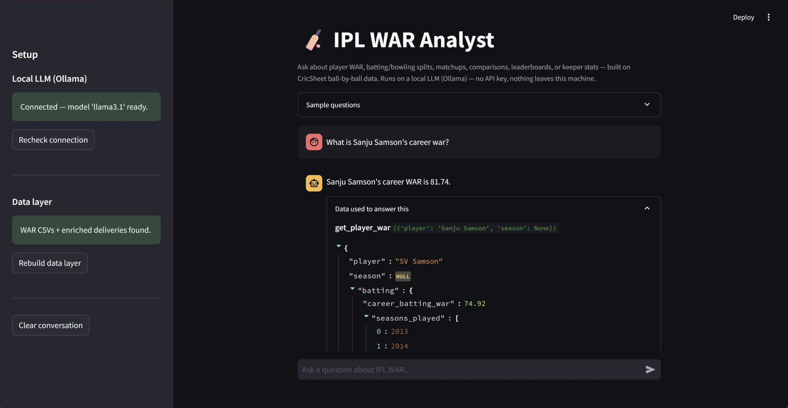

# IPL WAR Analyst



An analytics agent that computes **WAR (Wins Above Replacement)** for IPL batters, bowlers and fielders from CricSheet ball-by-ball data, and answers natural-language questions about it through a chat UI. The language model runs **locally via Ollama**, so there is no API key and nothing leaves your machine.

Example questions:

- "Who had the highest total WAR in the 2016 season?"
- "How does MS Dhoni perform against spin vs pace?"
- "How does Yuzvendra Chahal do against left-handed batters?"
- "Compare Virat Kohli and Rohit Sharma in 2016"
- "What are Rishabh Pant's keeping numbers?"

## How it works

```
CricSheet CSV2 / JSON
        |
ipl_war_batting.py / ipl_war_bowling.py / ipl_war_fielding.py   -> WAR CSVs
        |
data_layer.py  -> enriched deliveries (phase, bowler type, batter hand)
        |
tools.py       -> 6 pandas-backed query functions
        |
agent.py       -> local LLM (Ollama) picks a tool, calls it, writes the answer
        |
app.py         -> Streamlit chat UI (shows the raw tool output behind each answer)
```

**Tools:** `get_player_war`, `get_batting_splits` (vs pace/spin), `get_matchup_stats` (bowler vs LHB/RHB), `get_player_comparison`, `get_season_leaderboard`, `get_keeper_stats`. Player names are fuzzy-resolved, so "Virat Kohli" maps to CricSheet's `V Kohli`.

## WAR methodology (short)

- **Batting:** runs above the venue/phase average strike rate, minus a phase-specific wicket penalty, weighted by phase leverage (powerplay 1.1, middle 1.0, death 1.3).
- **Bowling:** runs saved against the venue/phase average economy, plus wicket credit, with the same phase weights. Run-outs are fielding credit.
- **Fielding:** catches, stumpings and run-outs (5 runs each), minus 0.5 per bye for the keeper.
- **Replacement level:** the 20th percentile of qualified players. `RUNS_PER_WIN = 10` for batting and bowling, `MIN_BALLS = 60` to qualify. Fielding uses its own scale (`RUNS_PER_WIN = 16`, minimum 5 matches).
- Seasons come from each match's start date, because CricSheet's season labels are ambiguous (for example "2020/21").

## Setup

1. Install Python 3.8+ and the dependencies:
   ```bash
   pip install -r requirements.txt
   ```
2. Download the data from [cricsheet.org/downloads](https://cricsheet.org/downloads/) and unzip into the project folder:
   - `ipl_csv2.zip` -> `ipl_csv2/`
   - `ipl_json.zip` -> `ipl_json/`
3. Install [Ollama](https://ollama.com/download) and pull a model:
   ```bash
   ollama pull llama3.1
   ```
4. Build the data layer (computes the WAR CSVs if missing, then the enriched deliveries file):
   ```bash
   python data_layer.py
   ```
5. Run the app:
   ```bash
   python -m streamlit run app.py
   ```

Set `OLLAMA_MODEL` to use a different model (for example `llama3.2` on a low-memory machine).

## Limitations

- Batter handedness and bowler type come from a hand-curated lookup (`player_lookup.py`). About 7% of balls fall back to `unknown`.
- The wicket penalties and phase multipliers are heuristic starting values, not calibrated against win probability.
- A small local model can occasionally misword an answer or pick the wrong tool. The UI shows the exact tool output behind every answer so results can be checked.

## Data

Ball-by-ball data from [CricSheet](https://cricsheet.org). Check their site for the current license terms and attribution requirements.
